# Лабораторная работа №6. Система контроля версий 

**Студент:** Мастепанов П. И.

**Группа:** 4514

**Дисциплина:** Основы программирования

## 1. Цель работы

Цель лабораторной работы - изучение базовых возможностей системыуправления версиями, опыт работы с Git Api, опыт работы с локальным и удаленным репозиторием.

## 2. Создание удалённого репозитория

Для выполнения лабораторной работы был создан аккаунт на GitHub. Исходный репозиторий был скопирован в личный аккаунт с помощью функции Fork.

В результате был создан собственный удалённый репозиторий, который использовался для дальнейшей работы.

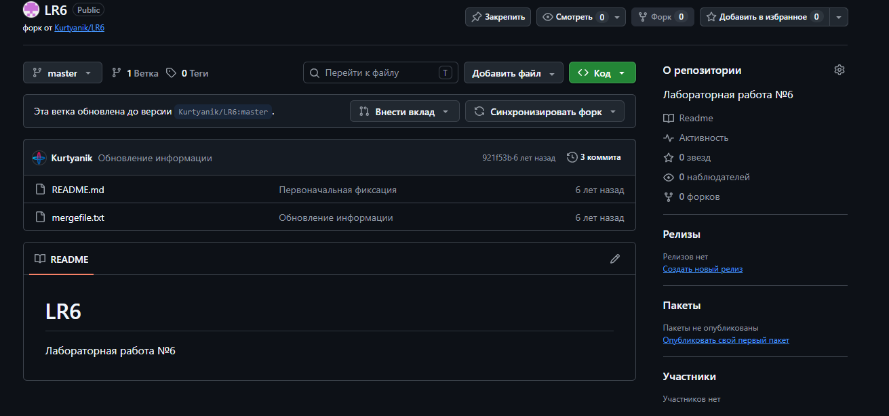

*Рисунок 1 - Созданный репозиторий на GitHub.*

## 3. Настройка Git

После установки Git была выполнена настройка имени пользователя и адреса электронной почты. Эти данные используются для определения автора при создании коммитов.

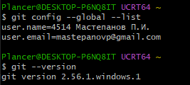

*Рисунок 2 - Настройки пользователя Git.*

## 4. Клонирование репозитория

Для получения локальной копии удалённого репозитория была использована команда `git clone`. Она позволяет загрузить содержимое репозитория с GitHub на компьютер.

После клонирования появилась локальная папка проекта, в которой выполнялись дальнейшие действия.

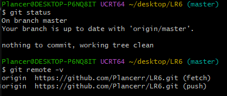

*Рисунок 3 - Клонирование удалённого репозитория.*

## 5. Получение изменений из GitHub

Для проверки взаимодействия локального и удалённого репозиториев через веб-интерфейс GitHub был создан файл `github_changes.txt`.

Затем была выполнена команда `git pull`, которая позволила получить изменения из удалённого репозитория. В результате созданный на GitHub файл появился в локальной копии проекта.

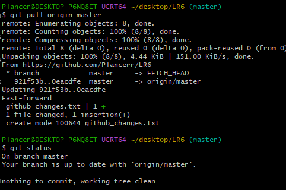

*Рисунок 4 - Получение изменений из удалённого репозитория.*

## 6. Просмотр истории коммитов

Для просмотра истории изменений проекта использовались команды `git log` и `git log --oneline`.

Команда `git log` отображает подробную информацию о сохранённых изменениях, а `git log --oneline` позволяет просматривать историю в сокращённом виде.

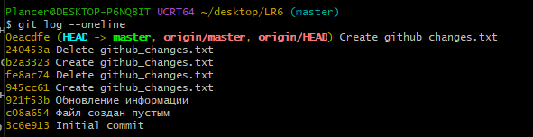

*Рисунок 5 - Просмотр истории коммитов.*

Дополнительно была изучена история всех веток с помощью команды `git log --oneline --graph --all`. Она позволяет увидеть последовательность коммитов и взаимосвязь между ветками.

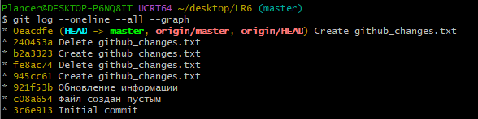

*Рисунок 6 - История всех веток проекта.*

## 7. Работа с ветками

Для изучения работы с ветками была создана дополнительная ветка `conflict-branch`.

В ней был изменён файл `mergefile.txt`, после чего изменения были сохранены отдельным коммитом.

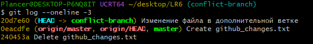

*Рисунок 7 - Изменение файла в дополнительной ветке.*

Затем изменения были выполнены и в основной ветке `master`. В результате две ветки получили разные версии одного и того же файла.

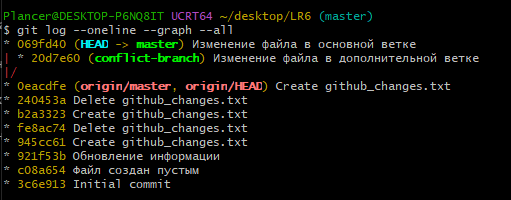

*Рисунок 8 - История двух веток перед слиянием.*

## 8. Слияние веток и разрешение конфликта

Для объединения изменений была выполнена команда `git merge conflict-branch`.

При слиянии Git обнаружил конфликт в файле `mergefile.txt`. Он возник потому, что в обеих ветках была изменена одна и та же часть файла.

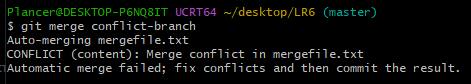

*Рисунок 9 - Возникновение конфликта при слиянии веток.*

Для разрешения конфликта файл был открыт в текстовом редакторе. После этого маркеры конфликта были удалены, а итоговое содержимое файла было отредактировано с учётом изменений обеих веток.

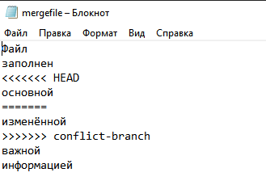

*Рисунок 10 - Работа с конфликтом в файле.*

После исправления файл был добавлен в индекс командой `git add mergefile.txt`. Затем результат разрешения конфликта был сохранён отдельным коммитом.

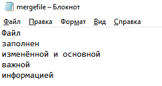

*Рисунок 11 - Файл после разрешения конфликта.*

## 9. Результат слияния и удаление ветки

После успешного разрешения конфликта была проверена история проекта. В ней отображаются изменения обеих веток и отдельный коммит, фиксирующий результат слияния.

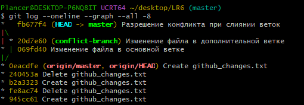

*Рисунок 12 - Результат успешного слияния веток.*

После слияния дополнительная ветка `conflict-branch` была удалена с помощью команды `git branch -d conflict-branch`.

Удаление ветки не привело к потере изменений, поскольку они уже были объединены с основной веткой `master`.

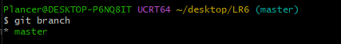

*Рисунок 13 - Удаление дополнительной ветки.*

## 10. Создание нескольких коммитов

Для изучения механизма сохранения версий был создан файл `notes.txt`.

В файл последовательно добавлялись новые записи. Каждое изменение сохранялось отдельным коммитом:

- `Создание файла заметок`;
- `Добавление второй записи`;
- `Добавление третьей записи`.

Это позволило изучить процесс последовательного сохранения изменений и проследить историю работы с файлом.

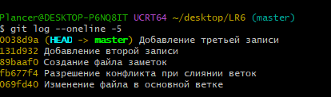

*Рисунок 14 - Последовательное создание трёх коммитов.*

## 11. Отмена последнего коммита

Для отмены изменений последнего коммита была использована команда `git revert HEAD`.

Git создал новый коммит, который отменяет изменения предыдущего. При этом сам отменённый коммит остался в истории проекта.

Таким образом, была изучена возможность отмены изменений без удаления ранее сохранённой истории.

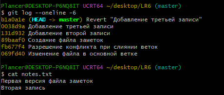

*Рисунок 15 - Отмена последнего коммита.*

## 12. Создание ветки для отчёта

Для оформления отчёта была создана отдельная ветка `report`. Она предназначена для выполнения изменений, связанных с документацией проекта.

Создание отдельной ветки позволяет вести работу над отчётом независимо от основной ветки `master`.

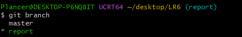

*Рисунок 16 - Создание отдельной ветки для отчёта.*

## 13. Форматированная история коммитов

Для получения истории коммитов в требуемом формате была использована команда:

`git log --all --pretty=format:"%h | %ad | %an | %s" --date=short`

Она позволяет вывести краткий идентификатор коммита, дату его создания, имя автора и комментарий.

**Результат выполнения команды:**
```bash
b1a0a1e | 2026-11-14 | 4514 Мастепанов П.И. | Revert "Добавление третьей записи"
0038d9a | 2026-11-14 | 4514 Мастепанов П.И. | Добавление третьей записи
131d932 | 2026-11-14 | 4514 Мастепанов П.И. | Добавление второй записи
89baaf0 | 2026-11-14 | 4514 Мастепанов П.И. | Создание файла заметок
fb677f4 | 2026-11-14 | 4514 Мастепанов П.И. | Разрешение конфликта при слиянии веток
069fd40 | 2026-11-14 | 4514 Мастепанов П.И. | Изменение файла в основной ветке
20d7e60 | 2026-11-14 | 4514 Мастепанов П.И. | Изменение файла в дополнительной ветке
0eacdfe | 2026-11-14 | Plancerr | Create github_changes.txt
240453a | 2026-11-14 | Plancerr | Delete github_changes.txt
b2a3323 | 2026-11-14 | Plancerr | Create github_changes.txt
fe8ac74 | 2026-11-14 | Plancerr | Delete github_changes.txt
945cc61 | 2026-11-14 | Plancerr | Create github_changes.txt
921f53b | 2020-11-21 | Kurtyanik | Обновление информации
c08a654 | 2020-11-21 | Kurtyanik | Файл создан пустым
3c6e913 | 2020-11-21 | Kurtyanik | Initial commit
```

## 14. Использованные команды Git

В ходе выполнения лабораторной работы использовались следующие команды:

```bash
git --version
git config --global user.name
git config --global user.email
git config --global --list
git clone
git status
git pull
git branch
git switch
git switch -c
git add
git commit
git log
git log --oneline
git log --oneline --graph --all
git merge
git branch -d
git revert HEAD
```

## 15. Вывод

В ходе лабораторной работы были изучены основные возможности системы контроля версий Git и сервиса GitHub.

Были выполнены создание и клонирование репозитория, получение изменений из удалённого репозитория, настройка пользователя и просмотр истории коммитов.

Также были изучены создание и переключение между ветками, слияние изменений и разрешение возникшего конфликта. Дополнительно была выполнена отмена последнего коммита с помощью команды `git revert` и создана отдельная ветка для оформления отчёта.

В результате работы были получены практические навыки использования Git для хранения истории изменений и управления версиями проекта.
